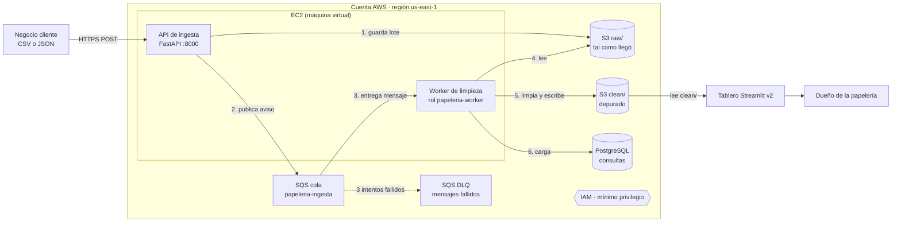

# E2 · Cimientos en la nube — Papelería

**Cubre:** Nube unidad 2 (temas 2.1 a 2.5) y Analítica unidad 3 (temas 3.1 y 3.2)
**Proveedor:** AWS · **Datos:** sintéticos (ver E0, sección 5)

> **Estado honesto de esta entrega.** Todo el código (ingesta, cola, worker, base de datos, tablero v2, series de tiempo y regresión) está escrito y probado en local con 30 pruebas automáticas. Lo que **requiere tu cuenta de AWS** (crear recursos, desplegar en la VM y tomar capturas) está preparado con scripts y pasos en la sección 9, pero marcado como **PENDIENTE** hasta que se ejecute. Los puntos PENDIENTE no deben presentarse como hechos en la revisión.

---

## 1. Arquitectura



**Ruta de escritura:** API → raw/ → cola → worker → clean/ + base de datos. **Ruta de lectura:** clean/ → tablero. La API responde `202` en cuanto el lote está en raw/ y en la cola; la limpieza ocurre después, sin que el usuario espere.

### Qué hace cada pieza y por qué está ahí

| Pieza | Servicio AWS | Justificación |
|---|---|---|
| Ingesta | EC2 + FastAPI | La rúbrica de E2 pide una VM; en E3 pasa a contenedor administrado. FastAPI da validación y documentación OpenAPI sin código extra. |
| Cola | SQS | Desacopla: si llegan mil registros de golpe, la API responde de inmediato y el worker procesa a su ritmo. Da reintentos y DLQ sin escribir código. |
| Worker | Proceso en la misma VM con rol propio | Misma limpieza de E1 convertida en módulo con pruebas. En E3 pasa a Lambda. |
| Data lake | S3 (`raw/` y `clean/`) | Objetos baratos y duraderos. `raw/` conserva la evidencia original; `clean/` es lo que consume el tablero. |
| Base de datos | PostgreSQL | Ver sección 3. |
| Identidad | IAM | Un usuario por integrante, nada con root, y roles de mínimo privilegio por servicio (sección 6). |

**Límites de red (E2):** el bucket bloquea todo acceso público; la API escucha en el puerto 8000 y su grupo de seguridad solo lo abre a la IP de quien presenta; SSH restringido a esa IP. En E4 se endurece a solo 443 y base de datos sin IP pública.

### Convención de nombres del data lake

```text
s3://<bucket>/raw/ventas/AAAA-MM-DD/<AAAAMMDDTHHMMSS>-<id8>.csv     # tal como llegó
s3://<bucket>/clean/ventas/AAAA-MM-DD/<AAAAMMDDTHHMMSS>-<id8>.csv   # mismo nombre, ya depurado
s3://<bucket>/{raw,clean}/ventas/historico/                          # carga inicial de E1
```

La fecha del prefijo es la de **recepción**, no la de las ventas. El nombre del lote es el mismo en `raw/` y `clean/`, así que cada archivo limpio se rastrea hasta su original.

## 2. Microservicio de ingesta

`services/ingesta/` (`core.py` con la lógica, `main.py` con FastAPI). Documentación interactiva en `/docs` y esquema en `/openapi.json`.

| Endpoint | Qué hace | Respuestas |
|---|---|---|
| `GET /salud` | Para monitoreo | 200 |
| `POST /ventas` | Lote en JSON (hasta 50,000 registros) | 202 aceptado · 422 estructura inválida · 503 infraestructura caída |
| `POST /ventas/csv` | Sube un CSV (máx. 5 MB) | 202 · 400 CSV ilegible · 413 muy grande · 422 estructura inválida · 503 |

**Validación de entrada (todo o nada):** columnas obligatorias, campos vacíos, tipos numéricos, `hora` entre 0 y 23 y fecha reconocible (`AAAA-MM-DD` o `DD/MM/AAAA`). Un lote con un solo error se rechaza completo con `422` y la lista de problemas (máximo 10), y **no toca** ni el almacén ni la cola (hay prueba para eso).

**Qué NO valida a propósito:** valores como cantidades negativas o atípicas pasan a `raw/` y los corrige el worker, porque `raw/` debe guardar lo que llegó. El rechazo de registros imposibles antes de que lleguen al modelo es de E4.

**Manejo de errores:** si falla S3 o SQS la API responde `503` sin exponer detalles internos. El orden es *primero raw/, después la cola*: si la cola falla, el lote ya está a salvo en raw/ y se puede reprocesar.

```bash
curl -F "archivo=@data/lote_demo.csv" http://<IP-DE-LA-VM>:8000/ventas/csv
# {"batch_id":"20261119T...","filas":795,"estado":"en cola","raw":"raw/ventas/2026-11-19/..."}
```

## 3. Base de datos

**Elegida: PostgreSQL (SQL).** Las ventas son datos tabulares con relaciones claras (lote → líneas de venta), y las preguntas del negocio son agregaciones por fecha, producto y canal, que SQL resuelve bien con índices. Un esquema fijo además sirve de segunda red de seguridad: `CHECK` rechaza cantidades ≤ 0 o canales desconocidos aunque algo se cuele del worker. NoSQL (p. ej. DynamoDB) escala mejor para accesos por llave y esquemas cambiantes, pero aquí no hay ninguna de las dos necesidades.

| Tabla | Columnas clave | Para qué |
|---|---|---|
| `lotes` | `batch_id` (PK), `procesado`, `filas_entrada`, `filas_salida`, `correcciones`, `estado` | Trazabilidad: qué llegó, cuándo y cuánto se corrigió |
| `ventas` | `batch_id` (FK), `ticket_id`, `fecha`, `hora`, `canal`, `producto`, `cantidad`, `precio_unitario`, `total` | Líneas de venta ya limpias |

Índices en `fecha`, en `(producto, fecha)` y en `batch_id`. El esquema completo está en `infra/aws/schema.sql`.

**Idempotencia:** SQS entrega *al menos una vez*, así que un mensaje puede llegar dos veces. Antes de insertar, el worker borra las filas del mismo `batch_id` (hay prueba).

**RDS o contenedor en la VM:** si RDS no entra en tu capa gratuita vigente (verifícalo antes de crearlo), se puede correr PostgreSQL en un contenedor dentro de la misma VM. Se gana costo cero y simpleza; se pierde alta disponibilidad, respaldos automáticos y que los datos viven en el disco de la misma máquina que puede morir. Decide con la capa gratuita de tu cuenta y **anota cuál elegiste y por qué** antes de entregar.

## 4. Cola y worker

`services/worker/worker.py`. Flujo: recibe mensaje → lee `raw/` → `limpiar()` (el módulo de E1, con pruebas) → escribe `clean/` → carga en la base → borra el mensaje.

- **Procesamiento asíncrono:** la API nunca espera al worker.
- **Reintentos:** si algo falla, el worker **no borra** el mensaje; tras el *visibility timeout* (120 s) la cola lo reentrega.
- **Cola de mensajes fallidos (DLQ):** con `maxReceiveCount = 3`, al tercer fallo SQS lo manda a `papeleria-ingesta-dlq` para revisarlo a mano y no bloquear el resto.
- **Robustez:** un lote pequeño donde una cantidad no se puede recuperar ya no truena; esa fila se descarta y se reporta como `descartados_sin_cantidad` (cambio en `limpieza.py`; no altera las cifras de E1).

Las mismas pruebas corren contra una cola en memoria que imita la semántica de SQS (`ColaLocal`), así los reintentos y la DLQ se prueban sin nube.

## 5. Identidad y acceso (IAM)

| Identidad | Permisos | No puede |
|---|---|---|
| Cuenta raíz | Solo MFA y alerta de presupuesto. **No se usa para operar.** | — |
| Un usuario IAM por integrante | Administración del proyecto | — |
| Rol `papeleria-ec2-ingesta` (la VM) | `PutObject` en `raw/*`, `SendMessage` en la cola, asumir el rol del worker | Leer `raw/`, tocar `clean/` |
| Rol `papeleria-worker` | `GetObject` en `raw/*`, `PutObject` en `clean/*`, recibir y borrar de la cola | Escribir en `raw/`, listar el bucket, nada más |
| Lectura del tablero | `ListBucket` y `GetObject` solo bajo `clean/` | Tocar `raw/`, escribir |

El worker corre con el perfil `worker` (`credential_source = Ec2InstanceMetadata`), de modo que usa el rol de mínimo privilegio y no el de la VM. **Ninguna credencial está en el código ni en el repositorio:** `boto3` las toma del rol o del perfil, y `.gitignore` excluye `.env`, `*.env`, `.aws/` y `*.pem`. Las políticas están en `infra/aws/policies/`.

## 6. Analítica: serie de tiempo

Serie: ventas diarias de 656 días (1 ene 2025 – 18 oct 2026). Todo está implementado a mano con NumPy en `services/modelos/series.py`; las cifras salen de `python services/modelos/reporte_e2.py` (`docs/reporte_e2.json`).

### Descomposición (periodo 7, modelo aditivo) — `img/e2_02_descomposicion.png`

| Componente | Resultado |
|---|---|
| Fuerza de la tendencia | 0.63 (0 = nada, 1 = domina) |
| Fuerza de la estacionalidad semanal | 0.45 |
| Ciclo semanal (efecto sobre el promedio diario) | sábado **+$1,157**, viernes +$381, jueves +$280, domingo **−$1,998** |

La "tendencia" incluye también las temporadas largas (regreso a clases y diciembre), porque una media móvil de 7 días no las separa del crecimiento; por eso su fuerza es alta aunque la pendiente lineal sea pequeña (ver regresión). El **residuo** es lo que ni el nivel ni la semana explican y contiene sobre todo ruido y el efecto quincena.

### Estacionariedad: prueba de Dickey-Fuller aumentada (con constante, rezagos por AIC)

| Serie | Estadístico | Rezagos | Crítico 5% | ¿Rechaza raíz unitaria? |
|---|---:|---:|---:|---|
| Ventas diarias | −3.81 | 20 | −2.86 | Sí (incluso al 1%: −3.43) |
| Diferencia de orden 1 | −6.22 | 20 | −2.86 | Sí |
| Diferencia semanal (rezago 7) | −6.46 | 20 | −2.86 | Sí |

**Lectura honesta:** la ADF solo prueba si hay *raíz unitaria*; no detecta que la media dependa del calendario. Aquí rechaza la raíz unitaria en la serie original, pero la descomposición y la ACF muestran estacionalidad semanal y temporadas, así que la serie **no es estacionaria en sentido débil** (su media cambia con el día y la temporada). Para ARIMA en E3 conviene **diferenciar a lag 7** (o usar SARIMA con `s = 7`): la diferencia semanal es claramente estacionaria. La implementación propia de ADF se compara contra `statsmodels` en `tests/test_series.py` (la prueba corre cuando `statsmodels` está instalado).

### ACF y PACF — `img/e2_03_acf_pacf.png`

| Rezago | ACF | PACF |
|---:|---:|---:|
| 1 | 0.38 | 0.38 |
| 7 | **0.58** | **0.45** |
| 14 | 0.44 | — |
| 21 | 0.31 | — |

Banda de confianza al 95%: ±0.077. **Interpretación:** la ACF es más alta en el rezago 7 (0.58) que en el 1 (0.38) y los picos en 7, 14 y 21 decaen despacio: la serie "recuerda" lo que pasó hace una semana. La PACF tiene valores significativos en los rezagos 1 a 5 y vuelve a saltar en el 7 (0.45), lo que apunta a una memoria corta más un componente semanal. **Punto de partida para E3:** SARIMA con parte estacional de periodo 7 y orden estacional `D = 1`; p, q y la parte estacional se decidirán comparando AIC, no se fijan aquí.

## 7. Analítica: regresión por mínimos cuadrados

`services/modelos/regresion.py`. La ecuación normal β = (XᵀX)⁻¹Xᵀy se resuelve a mano con NumPy (`np.linalg.solve`, sin invertir la matriz) y se compara contra scikit-learn.

**Modelo:** ventas diarias ~ tendencia (días) + día de la semana (lunes = base) + quincena + regreso a clases + vacaciones de diciembre. **Corte temporal:** se entrena con los primeros 628 días y se evalúa en los **últimos 28**; el orden nunca se revuelve.

| Variable | Coeficiente (MXN por día) |
|---|---:|
| Intercepto | 3,435 |
| Tendencia (por día) | +2.09 |
| Martes / miércoles / jueves / viernes | −40 / −174 / +90 / +279 |
| **Sábado** | **+1,023** |
| **Domingo** | **−2,190** |
| Quincena | +896 |
| **Regreso a clases** | **+3,006** |
| Vacaciones de diciembre | −1,880 |

| Métrica | Entrenamiento | Prueba (28 días) | Solo tendencia lineal |
|---|---:|---:|---:|
| MSE | 1,158,517 | 1,112,235 | 3,365,056 |
| RMSE | $1,076 | $1,055 | $1,834 |
| MAE | $838 | $830 | $1,388 |
| R² | 0.67 | 0.29 | 0.05 |

- **Coincide con scikit-learn:** diferencia máxima de coeficientes 5×10⁻¹⁰.
- **Sin sobreajuste:** el RMSE en prueba ($1,055) es casi igual al de entrenamiento ($1,076); es un error de ~23% de la venta diaria promedio. El R² de prueba es menor (0.29) porque esos 28 días tienen poca variación (sin temporada fuerte) y R² mide contra esa variación; por eso se reporta junto con el RMSE.
- **La recta de tendencia sola no explica casi nada** (R² = 0.05): sube $2.22 por día (~18% al año sobre el promedio; en E1 se reportó ~16% con otro método, comparando periodos; son del mismo orden). Lo que explica las ventas es el **calendario**: regreso a clases, quincena y fin de semana.
- **Residuos** (`img/e2_04_residuos.png`): Durbin-Watson 1.76 (2 = sin autocorrelación), sesgo 0.38 y curtosis en exceso 0.41, cercanos a una distribución normal. Queda una autocorrelación positiva **leve**: el modelo no captura todo el patrón de corto plazo. Eso justifica pasar a ARIMA/SARIMA en E3.
- Los efectos de calendario son los que sembró el generador sintético; con datos reales hay que reestimarlos.

## 8. Tablero v2

`streamlit run services/tablero/app.py`. Agrega, bajo las seis gráficas de E1, una sección **Serie de tiempo y regresión** con: recta de tendencia y ajuste del modelo (`e2_01`), descomposición (`e2_02`), ACF/PACF (`e2_03`), residuos (`e2_04`), la tabla de la prueba ADF y los coeficientes y métricas. Los títulos son hallazgos calculados de los datos filtrados (no etiquetas), y la sección pide al menos 120 días.

**Conectado a la nube:** con `DATA_SOURCE=s3`, el tablero lee **todos** los CSV de `clean/` del bucket (los que deja el worker más el histórico) y recarga cada 60 segundos. Sin esa variable lee el CSV local (desarrollo).

```bash
export DATA_SOURCE=s3 BUCKET=<tu-bucket> AWS_REGION=us-east-1   # y credenciales por perfil de AWS CLI
streamlit run services/tablero/app.py
```

## 9. Despliegue paso a paso — PENDIENTE de ejecutar con tu cuenta

Marca cada paso cuando lo hagas y guarda la evidencia indicada en `docs/img/`.

1. **Cuenta y seguridad.** MFA en la cuenta raíz; un usuario IAM por integrante; **no operar con root.** Alerta de presupuesto activa (plantilla *Zero spend budget* de AWS Budgets). Evidencia: `e2-mfa.png`, `e2-usuarios-iam.png`, `budget-alert.png`.
2. **Recursos base.** `cp infra/aws/variables.env.example infra/aws/variables.env`, llena los valores y corre `source infra/aws/variables.env && bash infra/aws/setup.sh`. Crea el bucket (sin acceso público, cifrado), la cola, la DLQ y los roles. Evidencia: `e2-bucket.png`, `e2-sqs.png`, `e2-roles.png`.
3. **Histórico.** `aws s3 cp data/ventas_papeleria_raw.csv s3://$BUCKET/raw/ventas/historico/` y lo mismo con `ventas_papeleria_clean.csv` hacia `clean/ventas/historico/`. Evidencia: `e2-s3-zonas.png`.
4. **VM.** Lanza una EC2 (revisa qué instancia entra en tu capa gratuita) con el perfil de instancia `papeleria-ec2-ingesta`. Grupo de seguridad: puerto 8000 y SSH **solo desde tu IP**.
5. **Base de datos.** Crea RDS PostgreSQL o corre un contenedor de PostgreSQL en la VM (sección 3); aplica `infra/aws/schema.sql`.
6. **Instalar y arrancar.** En la VM: clona el repo, `python3 -m venv ~/venv && ~/venv/bin/pip install -r requirements-vm.txt`, copia `infra/aws/papeleria.env.example` a `/etc/papeleria.env` (permisos 600) con tus valores, copia `infra/aws/aws_config_worker.example` a `~/.aws/config` ajustando el ARN, instala las dos unidades de `infra/aws/systemd/` y `sudo systemctl enable --now papeleria-ingesta papeleria-worker`.
7. **Demo de punta a punta.** `python data/generar_lote_demo.py`, luego `curl -F "archivo=@data/lote_demo.csv" http://<IP>:8000/ventas/csv`. En menos de 5 minutos los datos deben aparecer en `clean/`, en la base y en el tablero. Evidencia: `e2-demo-curl.png`, `e2-tablero-nuevos-datos.png`.
8. **Prueba de mínimos privilegios.** Intenta, con el perfil `worker`, escribir en `raw/` o borrar un objeto y muestra el `AccessDenied`. Es la evidencia más convincente del criterio de IAM. Evidencia: `e2-accessdenied.png`.
9. **Prueba de la DLQ.** Envía un mensaje que apunte a una clave que no existe y muestra que tras 3 intentos aparece en la DLQ. Evidencia: `e2-dlq.png`.
10. **Apagar lo que no se usa** (FinOps): detén la VM y la base cuando termines.

Las instrucciones de la demo en local (sin nube) están en el README.

## 10. Pruebas

`pytest tests -q` — 30 pruebas: limpieza (7), series de tiempo (6), regresión (5), ingesta + cola + worker de punta a punta (8) y API (4, requieren `fastapi` y `httpx`). Cubren, entre otras cosas: rechazo de lotes inválidos sin tocar la cola, reintentos y DLQ, idempotencia del worker, coeficientes recuperados contra valores conocidos y coincidencia con scikit-learn.

## 11. Límites conocidos

- Los `ticket_id` deben ser **únicos entre lotes** (el número de ticket del punto de venta). Si dos lotes repiten un número, el tablero los mezclaría al calcular el ticket promedio.
- La API **no tiene autenticación** ni límite de peticiones; eso es de E4.
- El tablero lee todos los CSV de `clean/` en cada recarga; con mucho histórico habrá que pasar a leer de la base de datos o a Parquet.
- La ADF, la ACF/PACF y la descomposición están implementadas a mano; las comparaciones contra `statsmodels` corren solo si está instalado.
- Los datos son sintéticos; las conclusiones de negocio hay que repetirlas con los datos reales de la papelería.

## 12. Uso de IA generativa (declaración)

Se usó Claude (Anthropic) para escribir el código de la ingesta, la cola, el worker, la base de datos, las funciones de serie de tiempo y regresión, las pruebas, los scripts de AWS y este documento. Las cifras de las secciones 6 y 7 salen de ejecutar `reporte_e2.py` sobre los datos. Los integrantes deben poder explicar, por ejemplo, por qué la API responde 202 y no 200, qué pasa si un mensaje llega dos veces, cómo se resuelve la ecuación normal y por qué la ADF rechaza la raíz unitaria aunque la serie tenga estacionalidad.
